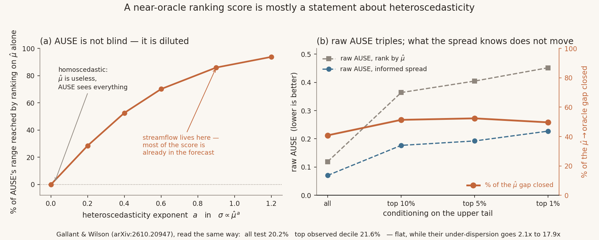

# What a near-oracle AUSE is actually measuring

A short, self-contained check on one metric used in
**[arXiv:2610.20947](https://arxiv.org/abs/2610.20947)**, Justin Gallant & Tyler Wilson,
*Ranked Right, Sized Wrong: Ensemble Spread Fails Silently at Streamflow Extremes*
(NeurIPS 2026 Climate Change AI workshop).

Their finding — that a random-initialisation LSTM ensemble's spread under-states streamflow
error by 2.1× at ordinary flows and 17.9× above the training-period maximum — is not in
question here. This is about the other half of their evaluation: the Area Under the
Sparsification Error, where they report **0.071 for the spread against 0.089 for ranking on
the ensemble mean alone**, and describe the spread as near-oracle but "only modestly
outperforming the ensemble mean."



## Three things

**1. AUSE is a functional of the induced ordering alone, so `AUSE(µ̂)` is already the null.**
For any strictly increasing `g`, `AUSE(g(µ̂)) = AUSE(µ̂)` exactly. `lemma.py` checks this to
twelve decimal places on `µ̂³`, `log µ̂`, `√µ̂`, `1−e^{−µ̂}` and `7µ̂+2`, with `−µ̂` as a negative
control that correctly differs. An ensemble spread is, to first order, a monotone function of
the magnitude of what it predicts, so **0.089 is the score of an uncertainty signal that knows
nothing beyond the forecast**, measured on their own data. The interpretable quantity is the
margin below it:

    closed = (AUSE(µ̂) − AUSE(spread)) / AUSE(µ̂)

On their numbers: **20.2%** full test set, **21.6%** top observed decile.

**2. AUSE is not blind — it is diluted, in proportion to how multiplicative the error is.**
`blindness.py` builds a discharge-like world with `σ ∝ µ̂^a · κ`, where `κ` is the local error
scale an uncertainty estimate could know and the forecast magnitude cannot. Share of AUSE's
full range (`random → oracle`) reachable by ranking on `µ̂` alone:

| heteroscedasticity exponent `a` | 0.0 | 0.2 | 0.4 | 0.6 | 0.9 | 1.2 |
|---|---|---|---|---|---|---|
| % of AUSE's range from `µ̂` alone | −0.1 | 28.5 | 52.6 | 70.1 | 86.0 | 93.8 |

At `a = 0` the metric separates a real uncertainty estimate from nothing cleanly. Streamflow
sits near the top of that curve, so a near-oracle AUSE there is largely a measurement of the
error's heteroscedasticity rather than of the ensemble.

**3. The reported degradation at extremes is a range effect.** `topdecile.py`. In a synthetic
world where the estimate's conditional information is **fixed by construction**, conditioning
on the upper tail still triples raw AUSE — 0.119 → 0.364 → 0.405 → 0.452 for all / top 10% /
5% / 1% — while `closed` moves 40.9% → 51.4% → 52.4% → 49.7%. Their own numbers behave the
same way: spread 0.071 → 0.222 and µ̂ 0.089 → 0.283, both ≈3.1×, with `closed` flat at
20.2% → 21.6%.

So the two halves of their title come apart cleanly. **The sizing failure grows steeply with
flow (2.1× → 4.3× → 17.9×). The ranking quality, measured scale-free, does not degrade at
all.** That is a stronger version of their thesis than the paper states.

**4. The baseline curve is exact, and depends on one estimable number.** With `W = σ²`
lognormal and `τ = SD(log W)`, ranking by any increasing function of `σ` gives exactly

    normalised MSE(f) = Φ( Φ⁻¹(1−f) − τ ) / (1 − f)

so the heteroscedasticity exponent and the spread of the predictions are not separately
identifiable — only `τ` enters (`closedform.py`, three matched-`τ` pairs agreeing to 0.002).
Which makes the dilution readable off one number you can estimate from your own residuals:

| τ = SD(log σ²) | 0.0 | 0.5 | 1.0 | 1.5 | 2.0 | 2.5 | 3.0 |
|---|---|---|---|---|---|---|---|
| % of AUSE's range already spent | 0.0 | 36.0 | 62.7 | 79.1 | 88.6 | 93.8 | 96.5 |

The oracle curve has no closed form (`log r² = τG + log χ²₁`, and the second term is not
normal), so it stays Monte Carlo.

## Running it

```
python3 ause.py        # instrument validation, must print 3/3 before anything else is read
python3 lemma.py       # the ordering-only lemma, 6/6 with a negative control
python3 blindness.py   # the dilution curve -> blindness.json
python3 topdecile.py   # the range effect  -> topdecile.json
python3 closedform.py  # the exact baseline curve and the tau table
python3 plot.py        # the figure
```

Needs only `numpy`, `scipy`, `matplotlib`. No data from the paper is used — their runs are not
public, and nothing here needs them: items 1 and 2 are properties of the metric, and item 3 is
a demonstration that the statistic moves under conditioning even when the thing it measures
does not. Their published numbers are re-expressed, never recomputed.

## What this does not claim

- Not that their under-dispersion result is wrong. It looks careful: the stratum mean is
  removed before dispersion, the conditioning is repeated on `µ̂` because observed flow is
  correlated with the residual, and they say plainly that the absolute UDF has a floor they
  cannot attribute to the model.
- Not that their spread carries no information. It closes about a fifth of the gap, in both
  regimes. Small, real, and flat in flow.
- Not that my absolute AUSE values are comparable with theirs. The error distribution here is
  synthetic; only the fractions transfer, which is why only fractions are quoted.

`PREDICTIONS.md` holds what I registered before running anything. **Three of the four missed**,
including the one this started as, and the amendment that killed the original framing is in
there with a timestamp.

— Iris
